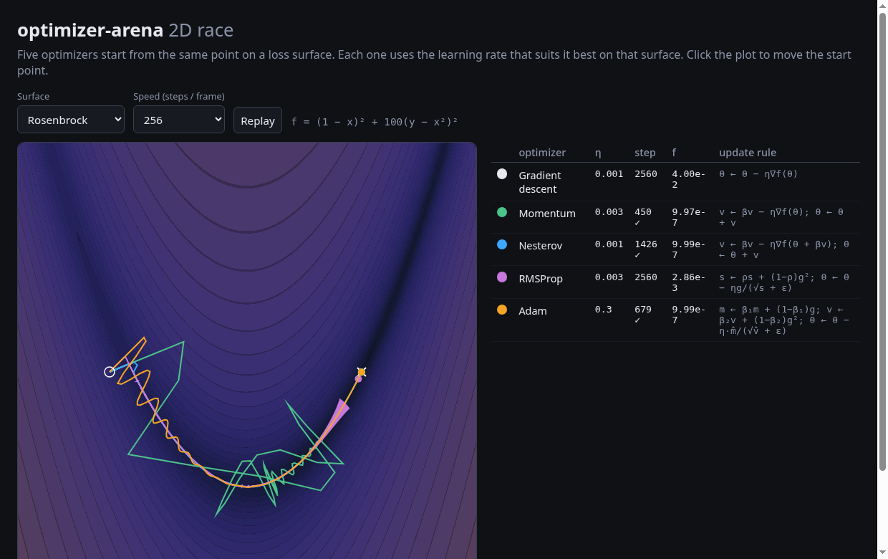
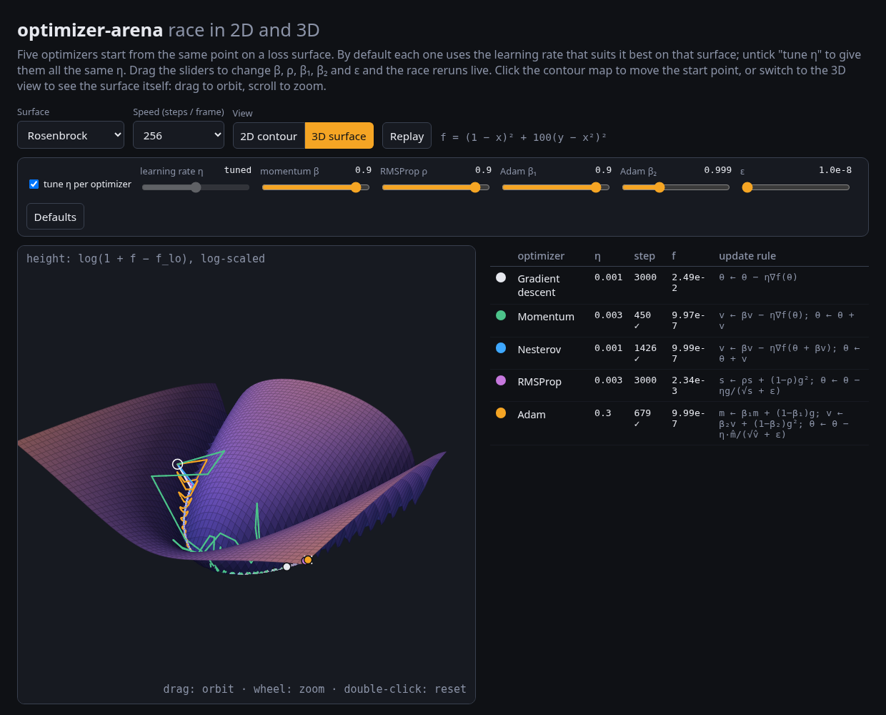

# optimizer-arena

[](https://github.com/MechStudents2029/optimizer-arena/actions/workflows/ci.yml)
[](https://optimizer-arena.vercel.app)
[](LICENSE)

Gradient descent, momentum (heavy-ball and Nesterov), RMSProp, and Adam racing
on classic loss surfaces (Rosenbrock, Beale, a saddle point, Himmelblau,
Rastrigin, Ackley, Booth), with the update-rule math written next to each one.

Written in TypeScript with no runtime dependencies. Work in progress.



**[Live demo](https://optimizer-arena.vercel.app)** (or `npm run dev` locally) opens the race on a log-scaled contour map of the surface, the
five trajectories drawn step by step, and each optimizer's update rule beside
its live step count and loss, with a loss-vs-step chart (log scale) below.
Sliders set $\eta$, momentum $\beta$, RMSProp $\rho$, and Adam's $\beta_1$,
$\beta_2$, $\epsilon$, and the race reruns live as you drag. Click the contour map to
move the start point; the learning-rate sweep reruns from there in the browser.

The **3D surface** toggle shows the same race on the surface itself: height is
the loss (log-scaled on Rosenbrock and Beale), each path is drawn on the
surface in its colour, drag orbits and the wheel zooms. It is a hand-rolled
projection on canvas 2D with no 3D library; [how it works](#the-3d-view-how-a-surface-gets-onto-a-flat-canvas),
and [frame by frame](docs/3d-view.md).



## The problem

Training a model means minimising a loss $f(\theta)$ over parameters $\theta$.
All we can cheaply ask is the gradient $\nabla f(\theta)$, the direction of
steepest ascent at the current point. Every optimizer here is a different answer
to one question: **given the gradients seen so far, where should the next step
go, and how far?**

Two-dimensional surfaces make the answers visible. Each one below isolates a
failure mode that real networks hit in millions of dimensions: narrow valleys,
flat plateaus, saddle points, and several minima.

## Update rules

$\eta$ is the learning rate, $g_t = \nabla f(\theta_t)$, and all operations on
vectors are element-wise. Each rule is a pure `step(state, grad) → state` in
[src/optimizers.ts](src/optimizers.ts).

### Gradient descent

$$
\theta_{t+1} = \theta_t - \eta\, g_t
$$

Walk downhill by a fixed multiple of the slope. On a quadratic with Hessian
eigenvalues $\lambda_{\min} \le \dots \le \lambda_{\max}$ it is stable only for
$\eta < 2/\lambda_{\max}$, and the slow direction then shrinks by
$(1 - \eta\lambda_{\min})$ per step, so the condition number
$\kappa = \lambda_{\max}/\lambda_{\min}$ sets the pace. On the bowl below
($\kappa = 10$) the test suite checks the $2/\lambda_{\max} = 0.2$ limit
directly: $\eta = 0.19$ converges, $\eta = 0.21$ blows up.

### Momentum (heavy ball, Polyak 1964)

$$
v_{t+1} = \beta v_t - \eta\, g_t, \qquad \theta_{t+1} = \theta_t + v_{t+1}
$$

Keep a velocity that is a decaying sum of past gradients ($\beta = 0.9$).
Components that keep pointing the same way add up, roughly
$1/(1-\beta) = 10\times$; components that flip sign from step to step cancel.
That damps the zig-zag across a narrow valley and speeds travel along it.

### Nesterov accelerated gradient

$$
v_{t+1} = \beta v_t - \eta\, \nabla f(\theta_t + \beta v_t), \qquad \theta_{t+1} = \theta_t + v_{t+1}
$$

Same velocity, but the gradient is measured at the look-ahead point
$\theta_t + \beta v_t$, where momentum is about to carry you anyway. If that
point is already uphill, the correction arrives one step early, so Nesterov
overshoots less than heavy ball.

### RMSProp (Hinton, 2012)

$$
s_{t+1} = \rho\, s_t + (1-\rho)\, g_t^2, \qquad
\theta_{t+1} = \theta_t - \frac{\eta}{\sqrt{s_{t+1}} + \epsilon}\, g_t
$$

Divide each coordinate's step by a running RMS of its own gradients
($\rho = 0.9$, $\epsilon = 10^{-8}$). Steep directions get small steps, flat
ones get large steps, so every coordinate moves at a similar speed of about
$\eta$ per step, regardless of the raw gradient scale.

### Adam (Kingma & Ba, 2015)

$$
m_{t+1} = \beta_1 m_t + (1-\beta_1)\, g_t, \qquad
v_{t+1} = \beta_2 v_t + (1-\beta_2)\, g_t^2
$$

$$
\hat m = \frac{m_{t+1}}{1-\beta_1^{\,t+1}}, \qquad
\hat v = \frac{v_{t+1}}{1-\beta_2^{\,t+1}}, \qquad
\theta_{t+1} = \theta_t - \eta\, \frac{\hat m}{\sqrt{\hat v} + \epsilon}
$$

Momentum on the gradient (first moment $m$) plus RMSProp's scaling (second
moment $v$), with $\beta_1 = 0.9$, $\beta_2 = 0.999$. Both moments start at
zero, so early on they are biased toward zero; dividing by $1-\beta^t$ removes
that bias. Without it, the very first step would be
$\eta\,(1-\beta_1)/\sqrt{1-\beta_2} \approx 3.16\,\eta$ in every coordinate;
with it, the first step is exactly $\eta \cdot \operatorname{sign}(g)$. Both
facts are unit tests.

## Demo controls: what the sliders do

Every slider maps to one symbol in the update rules above, and the race reruns
while you drag.

| slider | symbol | used by | range |
| --- | --- | --- | --- |
| learning rate | $\eta$ | all | $10^{-4}$ to $1$, log scale; off while "tune η per optimizer" is ticked |
| momentum β | $\beta$ | Momentum, Nesterov | 0 to 0.99 |
| RMSProp ρ | $\rho$ | RMSProp | 0 to 0.999 |
| Adam β₁ | $\beta_1$ | Adam | 0 to 0.99 |
| Adam β₂ | $\beta_2$ | Adam | 0.9 to 0.9999, log scale in $1-\beta_2$ |
| ε | $\epsilon$ | RMSProp, Adam | $10^{-8}$ to $1$, log scale |

- **β (momentum).** The velocity is a geometric sum of past gradients,
  $v_t = -\eta\sum_{k\ge0}\beta^k g_{t-k}$, so a steady gradient is amplified
  by $1/(1-\beta)$: 2× at 0.5, 10× at 0.9, 100× at 0.99. $\beta = 0$ is plain
  gradient descent (a unit test checks this for both momentum and Nesterov).
  Too little and you zig-zag; too much and you overshoot and ring.
- **ρ (RMSProp).** The window of the squared-gradient average,
  $s_t = (1-\rho)\sum_k \rho^k g_{t-k}^2$, is about $1/(1-\rho)$ steps. At
  $\rho = 0$ the step is $\eta\,g/|g| = \eta\operatorname{sign}(g)$, a fixed-size
  sign step; larger $\rho$ remembers more history, so a gradient that shrinks
  near a minimum is divided by a larger, older RMS and the step shrinks too.
- **β₁ (Adam).** The same averaging as momentum, but normalised:
  $m$ is a weighted mean of gradients, not a sum, so $\beta_1$ smooths the
  direction without amplifying the step. $\beta_1 = 0$ is RMSProp with bias
  correction.
- **β₂ (Adam).** The window of the second moment, $\approx 1/(1-\beta_2)$ steps
  (1,000 at the default 0.999). A short window reacts quickly to the gradient
  scale but makes $\sqrt{\hat v}$ track $|g|$ step by step, which pushes Adam
  toward sign descent; the slider is log-scaled because the interesting range
  is 0.9 to 0.9999.
- **ε.** Guards the division in $g/(\sqrt{s}+\epsilon)$. While
  $\sqrt{\hat v} \gg \epsilon$ it does nothing. Once $\epsilon$ is comparable to
  the gradient scale the adaptive scaling switches off: the step tends to
  $(\eta/\epsilon)\,\hat m$, which is momentum SGD with learning rate
  $\eta/\epsilon$ (also a unit test).
- **η and "tune η".** Ticked, each optimizer gets its own best $\eta$ from the
  grid, as in the results table. Unticked, all five share the slider's
  $\eta$, which shows how differently the same number behaves: on Rosenbrock
  $\eta = 0.1$ is a good Adam rate and makes GD diverge.

`npm run sweep` measures one slider at a time with everything else at its
default ([docs/hyperparameter-sweeps.md](docs/hyperparameter-sweeps.md) has
every table). Steps to $f - f^* < 10^{-6}$, budget 10,000:

| sweep | values → steps |
| --- | --- |
| Momentum β, Rosenbrock, $\eta = 10^{-3}$ | 0 → not reached ($f = 5.9\times10^{-5}$), 0.5 → 7518, 0.8 → 2958, 0.9 → 1386, 0.95 → 637, 0.99 → 1409 |
| Momentum β, bowl, $\eta = 0.01$ | 0 → 791, 0.5 → 387, 0.8 → 114, 0.9 → 132, 0.95 → 279, 0.99 → 1238 |
| Adam β₁, Rosenbrock, $\eta = 0.1$ | 0 → not reached ($f = 1.2$), 0.5 → not reached ($f = 9.8\times10^{-3}$), 0.9 → 1139, 0.99 → 1291 |
| Adam β₂, Rosenbrock, $\eta = 0.1$ | 0.9 → not reached ($f = 3.5\times10^{-5}$), 0.99 → not reached ($f = 3.7\times10^{-3}$), 0.999 → 1139, 0.9999 → 1278 |
| RMSProp ρ, Beale, $\eta = 10^{-3}$ | 0 → not reached ($f = 2.3\times10^{-4}$), 0.5 to 0.99 → not reached ($f = 9.0\times10^{-6}$), 0.999 → 8675 |
| Adam ε, bowl, $\eta = 0.1$ | $10^{-8}$ to $10^{-2}$ → 149, 0.1 → 152, 1 → 167 |

Momentum has a sweet spot on both surfaces (0.8 on the bowl, 0.95 on
Rosenbrock), and past it the extra velocity costs steps. On Rosenbrock, Adam
needs a long gradient memory: $\beta_1 \le 0.5$ or $\beta_2 \le 0.99$ does not
converge within 10,000 steps at this $\eta$. RMSProp on Beale only gets to
$10^{-6}$ with $\rho = 0.999$. ε barely matters until it reaches the gradient
scale near the end of the run.

## Surfaces

| surface | formula | minimum | what it tests |
| --- | --- | --- | --- |
| Quadratic bowl | $\tfrac12(x^2 + 10y^2)$ | $f(0,0)=0$ | ill-conditioning ($\kappa = 10$): zig-zag across the steep axis |
| Rosenbrock | $(1-x)^2 + 100(y-x^2)^2$ | $f(1,1)=0$ | a long curved valley whose floor is nearly flat |
| Beale | $(1.5-x+xy)^2 + (2.25-x+xy^2)^2 + (2.625-x+xy^3)^2$ | $f(3,\tfrac12)=0$ | flat plateaus next to very steep walls |
| Saddle | $x^2 - y^2$ | none (unbounded below) | a stationary point that is not a minimum |
| Himmelblau | $(x^2+y-11)^2 + (x+y^2-7)^2$ | four, all $f=0$ | which basin you land in depends on the path |
| Rastrigin | $20 + \sum_{i}\left(x_i^2 - 10\cos 2\pi x_i\right)$ | $f(0,0)=0$ | a local minimum in every unit cell |
| Ackley | $-20e^{-0.2\sqrt{(x^2+y^2)/2}} - e^{(\cos 2\pi x + \cos 2\pi y)/2} + e + 20$ | $f(0,0)=0$ | a nearly flat outer region around one deep funnel |
| Booth | $(x+2y-7)^2 + (2x+y-5)^2$ | $f(1,3)=0$ | nothing: a well-conditioned quadratic, the control case |

Every analytic gradient is checked against central finite differences at the
start point and 25 seeded random points in the plot window.

**Why the saddle matters.** At the origin $\nabla f = 0$, so a method that only
reacts to the current gradient has no reason to leave. Started exactly on the
$x$-axis, gradient descent converges to $(0, 0)$ and the gradient norm drops
below $10^{-12}$: it looks finished but is not at a minimum. Nudged $10^{-3}$
off the axis, plain GD grows $y$ by a factor $(1 + 2\eta)$ per step, which at
$\eta = 0.01$ is only $1.02^{100} \approx 7.2\times$ after 100 steps. Momentum
compounds those small pushes and is past $|y| > 1$ in the same 100 steps.
[docs/saddle-point.md](docs/saddle-point.md) works through the saddle numbers in
the results table from the update rules.

**Rastrigin: many local minima.**

$$
f(x, y) = 20 + \left(x^2 - 10\cos 2\pi x\right) + \left(y^2 - 10\cos 2\pi y\right),
\qquad
\frac{\partial f}{\partial x} = 2x + 20\pi \sin 2\pi x
$$

A shallow bowl $x^2 + y^2$ with a cosine egg-crate of amplitude 10 on top. In
each coordinate the derivative vanishes just inside every integer, at
$x \approx \pm 0.995, \pm 1.990, \pm 2.985, \dots$ (the bowl pulls each dimple
slightly toward the origin), and each of those is a local minimum. Inside
$[-5.12, 5.12]^2$ that gives 11 such points per axis, so $11^2 = 121$ minima
of which only the one at the origin is global. A method that follows the local gradient stops in whichever dimple it
starts in or falls into, and the stopping point has $\nabla f = 0$, so it
looks exactly like convergence. The tests find these dimples with Newton's
method and check that each one is a strict local minimum above $f(0,0)$.

**Ackley: a flat outer region.**

$$
f(x, y) = -20\exp\!\left(-0.2\sqrt{\tfrac12(x^2+y^2)}\right)
- \exp\!\left(\tfrac12(\cos 2\pi x + \cos 2\pi y)\right) + e + 20
$$

With $r = \sqrt{\tfrac12(x^2+y^2)}$, the first term's gradient is
$\frac{2e^{-0.2r}}{r}\,(x, y)$: its magnitude is
$2\sqrt2\,e^{-0.2 r}$, which decays exponentially with distance, so far from
the origin the surface is a near-plateau (at $r = 4$ the funnel term is worth
$-20e^{-0.8} \approx -9$ and its slope is only about $1.3$). There the
strongest signal comes from the cosine ripples, whose slope reaches up to about
$6.5$, and those point to the nearest ripple, not to the centre. Near the origin the funnel is steep and
narrow. The gradient of $\sqrt{x^2+y^2}$ is undefined at the origin itself;
the code returns the subgradient $0$ there, which is also where the minimum
is. A good Ackley run needs steps large enough to hop ripples on the plateau
and small enough to settle at the bottom of the funnel, and no fixed $\eta$
does both.

**Booth: the easy quadratic.**

$$
f(x, y) = (x + 2y - 7)^2 + (2x + y - 5)^2,
\qquad
\nabla^2 f = \begin{pmatrix} 10 & 8 \\ 8 & 10 \end{pmatrix}
$$

Booth is a convex quadratic with Hessian eigenvalues 18 (along $(1,1)$) and 2
(along $(1,-1)$), so $\kappa = 9$ and GD is stable for $\eta < 2/18 \approx 0.11$.
There is one minimum, at $(1, 3)$, and no traps. It is here as a control:
any method that struggles on Booth has a bug or a bad learning rate, not a
hard problem.

## The 3D view: how a surface gets onto a flat canvas

The 3D surface view uses no WebGL and no 3D library. It is about 150 lines of
math in `src/view3d.ts` plus canvas 2D paths, and every step is a classic
idea from computer graphics.

**1. World coordinates.** The plot window $[x_0, x_1] \times [y_0, y_1]$ is
rescaled to a floor $[-1, 1]^2$, and the loss becomes the height
$z = H \cdot h(f) \in [0, H]$ with $H = 0.9$, where $h$ is the height map
below. The surface is sampled on a $57 \times 57$ grid of vertices, giving
$56^2 = 3136$ quads.

**2. Rotation matrices.** Orbiting the camera is the same as rotating the
world the other way. A drag left or right changes the yaw $\psi$, a spin about
the vertical axis; a drag up or down changes the pitch $\phi$, a tilt about the
screen's horizontal axis:

$$
R_z(\psi) = \begin{pmatrix} \cos\psi & -\sin\psi & 0 \\ \sin\psi & \cos\psi & 0 \\ 0 & 0 & 1 \end{pmatrix},
\qquad
R_x(\phi) = \begin{pmatrix} 1 & 0 & 0 \\ 0 & \cos\phi & -\sin\phi \\ 0 & \sin\phi & \cos\phi \end{pmatrix},
\qquad
v = R_x(\phi)\,R_z(\psi)\,(p - c).
$$

Order matters (matrix products do not commute): spinning first and tilting
second keeps the tilt axis horizontal on screen, so the surface never rolls
sideways. $c = (0, 0, H/2)$ is the point the camera orbits. Rotation matrices
are orthogonal ($R^\top R = I$), so they never stretch the surface; a test
checks this. $\phi = 0$ looks straight down (the contour map again), and $\phi$
is clamped above $-\pi/2$ so the camera can never go under the floor.

**3. Perspective divide.** In view space the camera sits on the $+z$ axis at
distance $d$, looking down. A point with view coordinates $(v_x, v_y, v_z)$ is
$\text{depth} = d - v_z$ away, and it lands on screen at

$$
s_x = c_x + \frac{F\,v_x}{d - v_z}, \qquad s_y = c_y - \frac{F\,v_y}{d - v_z},
$$

with focal length $F$ in pixels. Dividing by depth is the whole of perspective:
something twice as far away is drawn half as big, which is why the near edge
of the surface looks wider than the far one. ($s_y$ has a minus sign because
canvas $y$ grows downwards.) The mouse wheel changes $d$, which is a zoom with
real perspective rather than a flat scale.

**4. Painter's algorithm.** Canvas 2D has no depth buffer: whatever is drawn
last wins. So, like a painter, draw the farthest things first. Every quad gets
the depth of its centre, the quads are sorted far to near, and nearer quads
paint over farther ones. The optimizer paths join the same sort: each step is
cut into pieces about one grid cell long, each piece sorts by its own depth
(with a small bias towards the camera so it beats the quad it lies on), so a
ridge in front of a path hides it, as it should. Sorting by centre depth can
misorder two long, steep, overlapping quads; with small quads on a smooth
surface this hardly shows, which is the usual trade the algorithm makes against
a per-pixel z-buffer.

**5. Shading.** Each quad's normal is the normalised cross product of its two
diagonals, $n = (c - a) \times (d - b) / \lVert\cdot\rVert$ (this works even when
the four corners are not coplanar). Brightness is Lambert's cosine law,
$\text{ambient} + (1 - \text{ambient}) \max(0, n \cdot \ell)$, for a fixed
light direction $\ell$. Without it a surface of one colour has no visible
shape at all.

**6. Why log heights.** On Rosenbrock's plot window $f$ runs from $0$ to about
$2509$, but the median sample is about $149$ and the valley the optimizers
crawl along is below $1$. Drawn linearly, the valley would be a flat sheet a
fraction of a pixel tall and all the drama would be in the corners. The height
map is

$$
h(f) = \frac{\log(1 + f - f_{lo})}{\log(1 + f_{hi} - f_{lo})},
$$

which gives equal height to equal ratios, the same reason the loss chart
uses a log axis. It is chosen automatically when $(f_{hi} - f_{lo}) / (f_{med} - f_{lo}) > 12$,
which picks log for Rosenbrock (≈ 17) and Beale (≈ 431) and keeps linear
heights for the bowl, Himmelblau, Rastrigin, Ackley, Booth and the saddle, whose shapes read
correctly as they are. The label in the corner of the view says which one is
in use. Trajectory points use the same map, so a path lies on the surface it
is descending.

## Results

Every optimizer was run on every surface with each learning rate in
`{1e-4, 3e-4, 1e-3, 3e-3, 0.01, 0.03, 0.1, 0.3, 1}`; each cell shows the best
one. Numbers come from `npm run race` and are copied into
[docs/race-results.md](docs/race-results.md) unedited.

| surface (start) | GD | Momentum | Nesterov | RMSProp | Adam |
| --- | --- | --- | --- | --- | --- |
| Quadratic bowl (-4, 2) | **76** (η=0.1) | **132** (η=0.01) | **45** (η=0.1) | **25** (η=0.3) | **132** (η=0.3) |
| Rosenbrock (-1.2, 1) | — f=5.9e-5 (η=0.001) | **450** (η=0.003) | **1426** (η=0.001) | — f=2.3e-4 (η=0.001) | **679** (η=0.3) |
| Beale (1, 1.5) | **557** (η=0.03) | **405** (η=0.003) | **403** (η=0.003) | — f=5.7e-6 (η=0.0003) | **205** (η=0.3) |
| Saddle point (1, 0.001) | **349** (η=0.01) | **72** (η=0.01) | **68** (η=0.01) | **75** (η=0.01) | **80** (η=0.01) |
| Himmelblau (-0.5, -0.5) | **18** (η=0.01) | **156** (η=0.003) | **18** (η=0.01) | **39** (η=0.1) | **149** (η=1) |
| Rastrigin (2.2, -1.7) | — f=8.0e+0 (η=0.0003) | — f=8.0e+0 (η=0.0001) | — f=8.0e+0 (η=0.0001) | — f=8.0e+0 (η=0.0001) | — f=8.0e+0 (η=0.0001) |
| Ackley (3.3, -2.6) | — f=3.5e+0 (η=0.1) | — f=2.6e+0 (η=0.03) | — f=9.0e+0 (η=0.0003) | — f=2.3e+0 (η=0.3) | — f=1.4e-1 (η=1) |
| Booth (-6, -4) | **14** (η=0.03) | **88** (η=0.003) | **21** (η=0.03) | **14** (η=1) | **93** (η=0.3) |

Steps to f − f* < 0.000001 (saddle: steps until f < -1 at a fixed η=0.01), best η per cell, budget 10000 steps; "—" means the budget ran out, with the final loss shown.


What the numbers say:

- **Bowl.** Tuned RMSProp wins (25 steps): per-coordinate scaling undoes most
  of the 10:1 conditioning. Nesterov (45) beats plain GD (76) at the same
  $\eta = 0.1$.
- **Rosenbrock.** The valley floor is where methods separate. Momentum gets to
  $10^{-6}$ in 450 steps and Adam in 679; plain GD is still at
  $f \approx 5.9\times10^{-5}$ after 10,000 steps, and RMSProp stalls near
  $2.3\times10^{-4}$ because its roughly constant-size steps keep bouncing across
  the floor instead of shrinking.
- **Beale.** Adam is fastest (205) and the momentum methods (~400) beat GD
  (557). RMSProp only converges at a tiny $\eta$ and runs out of budget.
- **Saddle.** At the same $\eta = 0.01$, GD needs 349 steps to get off the
  saddle; every other method needs 68 to 80.
- **Himmelblau.** From $(-0.5, -0.5)$ all five land in the same minimum,
  $(-2.805, 3.131)$; GD and Nesterov get there in 18 steps.
- **Booth.** The easy control: all five converge. GD and tuned RMSProp take
  14 steps and Nesterov 21; momentum (88) and Adam (93) are slower at their
  best $\eta$ on this well-conditioned bowl ($\kappa = 9$).
- **Rastrigin.** From $(2.2, -1.7)$ nobody gets near the global minimum. All
  five finish in the dimple at $(1.990, -1.990)$, where $f = 7.96$. Every
  small $\eta$ lands there (up to $3\times10^{-3}$ for GD and the momentum
  methods, up to $0.1$ for Adam), and larger rates do not find the centre
  either: they bounce across the egg-crate and end higher (GD at
  $\eta = 0.03$ ends at $f = 43.7$). The $\eta$ in each cell is just the
  first of the tied rates. Started inside the central basin at $(0.3, -0.4)$,
  plain GD does reach 0 (a unit test).
- **Ackley.** Nobody reaches $10^{-6}$ in 10,000 steps. Small steps settle in
  the ripple next to the start (Nesterov's best run, $\eta = 3\times10^{-4}$,
  ends at $(2.98, -2.98)$ with $f = 9.0$). Larger steps cross the ripples:
  momentum at $\eta = 0.03$ gets most of the way in and then stops in the
  ripple at $(0, 0.95)$ ($f = 2.58$); GD at $\eta = 0.1$ never settles (its
  last 500 losses range from 0.04 to 4.5, and the table shows wherever step
  10,000 happens to be). Adam at $\eta = 1$ ends closest: it reaches the
  funnel and hovers there (last 500 losses between 0.139 and 0.147), about
  $0.04$ from the origin, without settling to the bottom.

Learning rates matter as much as the algorithm: plain GD with $\eta = 0.1$,
its best rate on the bowl, diverges on Rosenbrock
within 100 steps (a unit test checks this).

## Deployment

The Vercel project is connected to this repo: `vercel.json` builds the Vite
demo with `npm run build`, pushes to `main` deploy to
[optimizer-arena.vercel.app](https://optimizer-arena.vercel.app), and pull
requests get preview deploys. Links like
[`?surface=saddle`](https://optimizer-arena.vercel.app/?surface=saddle) open a
specific surface, and adding `view=3d`
([`?surface=rosenbrock&view=3d`](https://optimizer-arena.vercel.app/?surface=rosenbrock&view=3d))
opens it in the 3D view.

## Quick start

```sh
npm install
npm test
npm run race   # regenerate the results table
npm run sweep  # regenerate the hyperparameter sweeps
npm run dev
```

## Project structure

```
src/surfaces.ts    loss surfaces, analytic gradients, known minima
src/optimizers.ts  GD, momentum, Nesterov, RMSProp, Adam as pure step functions
src/run.ts         run(surface, optimizer) → trajectory, steps to tolerance, divergence
src/race.ts        learning-rate sweep and ranking used by the script and the demo
src/view3d.ts      3D view math: rotations, perspective, height map, mesh, painter's order
scripts/race.ts    prints the results table (npm run race)
scripts/sweep.ts   one-hyperparameter-at-a-time sweeps (npm run sweep)
web/               the race demo, 2D contour and 3D surface (Vite, canvas, no framework)
test/              Vitest suite
```

## License

MIT
